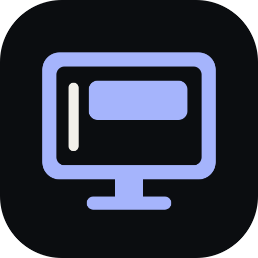

# plash-desktop-customisations

  

Minimal CSS and JavaScript overlays for [Plash](https://sindresorhus.com/plash), the macOS app that turns any website into your desktop wallpaper. Each style restyles one site so it sits cleanly behind your windows.

## Preview

## Styles

| Style   | Website              | What it does                                                                                                                                       |
| ------- | -------------------- | -------------------------------------------------------------------------------------------------------------------------------------------------- |
| Style 1 | https://simply.fyi   | Hides the page chrome, moves the page's text into a frosted, blurred card at the top, and adds a large vertical clock from time.pablopunk.com on the left |

## Installing a style

1. In Plash, open **Add Website** and enter the style's website URL.
2. Expand **Advanced**.
3. Paste the contents of the style's `.css` file into **CSS** and its `.js` file into **JavaScript**.
4. For Style 1, also tick **Use print styles**.

The JavaScript expects the page to have an element with the id `output`, which simply.fyi provides. On a page without it the clock is still added and the card is skipped.

## Checks

CI checks that every style's JavaScript parses and that the images the README links to exist.
